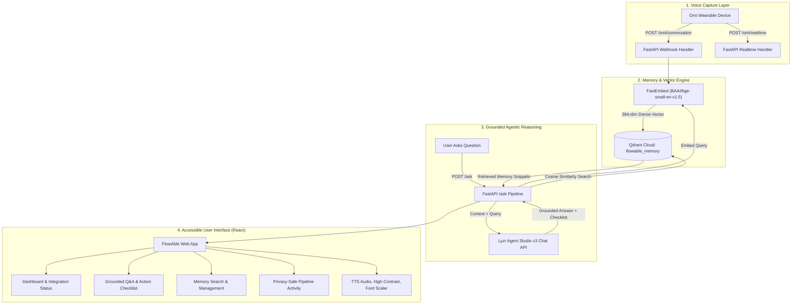

# FlowAble — Voice Memory & Adaptive Accessibility Assistant

**Hackathon:** Stop Prompting, Solo Agents Hackathon  
**Track:** Track 4: Accessibility & Adaptive Assistants  
**Mandatory Integrations:** Omi (Voice Capture) + Qdrant Cloud (Persistent Vector Memory) + Lyzr Agent Studio (Reasoning)  
**Repository:** [https://github.com/jayanthimg2006-creator/flowable](https://github.com/jayanthimg2006-creator/flowable)

---

## 1. Problem & Solution

### The Challenge
For millions of individuals with cognitive disabilities, memory challenges, ADHD, age-related memory decline, or sensory overload, keeping track of rapid spoken instructions—such as medical advice, supervisor tasks, or daily reminders—is exhausting. Traditional chatbots require users to remember what was said, manually type prompts, and repeatedly re-contextualize the conversation.

### The FlowAble Solution
**FlowAble** is a voice-first accessibility assistant that connects:
1. **Omi Wearable / Voice Webhooks** for ambient, hands-free conversation capture.
2. **Qdrant Cloud (`flowable-memory` cluster)** for persistent semantic memory storage and fast vector retrieval.
3. **Lyzr Agent Studio (v3 Chat API)** for grounded reasoning, hallucination-free explanations, and interactive task checklists.
4. **An Accessible React Frontend** featuring WCAG AAA contrast, keyboard accessibility, text-to-speech read-aloud, and adaptive font sizing.

---

## 2. Architecture & The End-to-End Execution Loop

### System Architecture Diagram



### The 10-Step Execution Loop
1. **Voice Input:** The user speaks instructions or conversations via their Omi wearable.
2. **Webhook Ingestion:** Omi sends a memory payload to `POST /omi/conversation`.
3. **Validation & Extraction:** FastAPI validates the payload, extracting speakers, timestamps, structured summaries, and action items.
4. **Dense Vectorization:** FastEmbed transforms the transcript into a 384-dimensional dense vector using `BAAI/bge-small-en-v1.5`.
5. **Idempotent Storage:** Qdrant Cloud stores the vector and metadata under deterministic UUIDv5 keys to prevent duplicates on webhook retries.
6. **User Question:** The user opens FlowAble and asks a question (via text or microphone).
7. **Semantic Retrieval:** FlowAble embeds the query and retrieves the most relevant memories from Qdrant using cosine similarity.
8. **Context Injection:** The retrieved memories and question are sent to Lyzr Agent Studio.
9. **Grounded Reasoning:** Lyzr synthesizes an answer strictly based on the retrieved evidence, breaking tasks into simple, numbered steps.
10. **Accessible Delivery:** The UI renders the answer, source transparency badges, and an interactive task checklist with one-click Read Aloud audio.

---

## 3. Mandatory Integrations Breakdown

| Technology | Role | Implementation Details |
| :--- | :--- | :--- |
| **Omi** | Ambient Voice Capture | Endpoints: `POST /omi/conversation` & `POST /omi/realtime`. Extracts structured transcripts, speakers, and action items with idempotency deduplication. |
| **Qdrant Cloud** | Vector Memory | Cluster: `flowable-memory`. Collection: `flowable_memory`. Official `qdrant-client` storing 384-dim FastEmbed vectors with UUIDv5 deterministic IDs. |
| **Lyzr Agent Studio** | Agentic Reasoning | Endpoint: `https://agent-prod.studio.lyzr.ai/v3/inference/chat/` with `x-api-key`. Grounded memory prompting, accessible step breakdowns, and zero hallucination. |

---

## 4. Quickstart Guide (Local Setup)

### Prerequisites
- Python 3.10+ (Python 3.11 recommended)
- Node.js 18+ and npm
- Git

### Step 1: Clone the Repository
```bash
git clone https://github.com/jayanthimg2006-creator/flowable.git
cd flowable
```

### Step 2: Set Up Python Virtual Environment
**On Windows (PowerShell):**
```powershell
python -m venv .venv
.\.venv\Scripts\Activate.ps1
pip install -r requirements.txt
```

**On macOS / Linux:**
```bash
python3 -m venv .venv
source .venv/bin/activate
pip install -r requirements.txt
```

### Step 3: Configure Environment Variables
Copy `.env.example` to `.env`:
```bash
cp .env.example .env
```
Open `.env` and fill in your actual credentials:
```env
# Qdrant Vector Memory (Existing cluster: flowable-memory)
QDRANT_URL=https://your-cluster-id.us-east4-0.gcp.cloud.qdrant.io:6333
QDRANT_API_KEY=your_qdrant_api_key_here
QDRANT_COLLECTION_NAME=flowable_memory

# Lyzr Agent Studio
LYZR_API_KEY=your_lyzr_api_key_here
LYZR_AGENT_ID=your_lyzr_agent_id_here
LYZR_CHAT_URL=https://agent-prod.studio.lyzr.ai/v3/inference/chat/

# Server
PORT=8000
ENVIRONMENT=development
```

> **Security Note:** Never commit your `.env` file to Git. FlowAble's `.gitignore` automatically prevents `.env` from being tracked.

### Step 4: Build or Run the Frontend
To build the frontend for single-port FastAPI serving:
```bash
cd frontend
npm install
npm run build
cd ..
```

### Step 5: Start FlowAble
```bash
python run.py
```
Open your browser at: **[http://localhost:8000](http://localhost:8000)**

---

## 5. Configuring Omi Webhooks

To test with a physical Omi device or mobile app:

1. Expose your local port 8000 using **ngrok**:
   ```bash
   ngrok http 8000
   ```
2. In the Omi App or Developer Settings, configure your webhook endpoint:
   - **Conversation Webhook URL:** `https://<your-ngrok-subdomain>.ngrok-free.app/omi/conversation`
   - **Realtime Webhook URL:** `https://<your-ngrok-subdomain>.ngrok-free.app/omi/realtime`
3. Speak into Omi. The transcript will stream and be stored in Qdrant automatically.

*(You can also simulate Omi webhooks directly from the FlowAble Memory UI tab by clicking **Simulate / Add Memory**).*

---

## 6. API Reference

| Method | Endpoint | Description |
| :--- | :--- | :--- |
| `GET` | `/health` | Basic health check returning status and version |
| `GET` | `/status` | Deep health check testing Qdrant, Lyzr, and Omi connectivity |
| `POST` | `/ask` | The complete grounded memory retrieval + Lyzr reasoning loop |
| `POST` | `/omi/conversation` | Omi conversation / memory webhook target |
| `POST` | `/omi/realtime` | Omi realtime streaming segment webhook |
| `GET` | `/api/memories` | Retrieve recent stored memories from Qdrant |
| `POST` | `/api/memories/search` | Semantic vector search across memories |
| `POST` | `/api/memories/manual` | Direct memory insertion for testing / voice simulation |
| `DELETE` | `/api/memories/{id}` | Delete memory point from Qdrant by ID |
| `GET` | `/api/activity` | Privacy-safe live pipeline event log |
| `GET` | `/api/stats` | System statistics and point counts |

---

## 7. Running the Test Suite

FlowAble includes comprehensive automated tests covering all endpoints, webhook schemas, idempotency, and mocked reasoning paths:

```bash
pytest -v
```

All 15 tests verify:
- Application startup and health checks
- Omi webhook payload processing and malformed payload rejection
- Qdrant deterministic UUIDv5 generation and collection creation
- Lyzr prompt grounding and accessible step extraction
- Full end-to-end `/ask` execution loop
- SPA static asset delivery and routing

---

## 8. Cloud Deployment (Render)

FlowAble is pre-configured for zero-downtime deployment on **Render**:

### Option A: 1-Click Render Blueprint (Recommended)
Because FlowAble includes a [`render.yaml`](file:///c:/flowable/render.yaml) blueprint and multi-stage [`Dockerfile`](file:///c:/flowable/Dockerfile):
1. Push your repository to GitHub.
2. In the Render Dashboard, click **New +** -> **Blueprint**.
3. Connect your repository. Render reads `render.yaml` automatically and configures the service.
4. In the Render environment settings, enter your secret credentials (`QDRANT_URL`, `QDRANT_API_KEY`, `LYZR_API_KEY`, `LYZR_AGENT_ID`).
5. Click **Apply**. Render builds the multi-stage Docker image (building the React frontend and packaging the FastAPI backend) and deploys.

### Option B: Manual Web Service (Docker Runtime)
1. In Render Dashboard, click **New +** -> **Web Service**.
2. Connect your GitHub repository.
3. Choose **Docker** as the runtime.
4. Add your environment variables:
   - `QDRANT_URL`
   - `QDRANT_API_KEY`
   - `LYZR_API_KEY`
   - `LYZR_AGENT_ID`
   - `ENVIRONMENT=production`
5. Click **Deploy**. Render generates your public HTTPS URL (e.g. `https://flowable.onrender.com`), which is ready to be configured as your Omi webhook endpoint!

---

## 9. Accessibility Features (Track 4 Spotlight)

- **Adaptive Mode Font Scaling:** Easily switch between Normal, Large, and Extra-Large text sizes.
- **High-Contrast Display:** Instant contrast enhancement for low-vision users.
- **Text-to-Speech (TTS):** One-click "Read Aloud" button for reading answers aloud to users with cognitive, reading, or visual impairments.
- **Interactive Step Checklists:** Agent-generated action steps are transformed into interactive checkboxes so users can track their progress without mental strain.
- **Zero-Hallucination Grounding:** FlowAble explicitly informs users if information is missing rather than inventing false facts or appointments.

---

## 10. Hackathon Demo Script

For a detailed 5-minute presentation script with scene timings and talking points, see [DEMO_SCRIPT.md](file:///c:/flowable/DEMO_SCRIPT.md).
